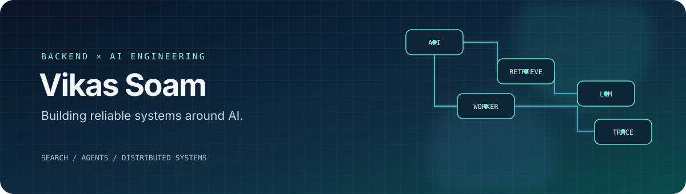

<a href="https://viratsoam.github.io/VikasSoam/"><strong>Portfolio</strong></a>
 · 
<a href="mailto:soamvikas000@gmail.com"><strong>Email</strong></a>
 · 
<a href="https://github.com/Viratsoam"><strong>Repositories</strong></a>

I build the systems that make AI useful.
Backend engineering · LLM applications · Search & retrieval · Reliable async workflows

A bit about me
I'm a backend engineer with 5+ years of software development experience, now focused on AI engineering: taking LLM and retrieval ideas beyond a demo and shaping them into systems that are testable, observable, and dependable.
My background spans enterprise search, distributed backend services, data ingestion, and healthcare document workflows. I enjoy the engineering around AI just as much as the model call itself: clean interfaces, retrieval quality, failure handling, evaluation, and cost-aware execution.
Building with: Python, FastAPI, Node.js, NestJS, and TypeScript
AI systems: LLM workflows, tool calling, embeddings, RAG, and agent orchestration
Search: Elasticsearch, hybrid retrieval, semantic search, and relevance tuning
Production patterns: queues, retries, idempotency, audit trails, caching, and observability
Learning now: AI-first software engineering, agent evaluation, and robust tool-using workflows
Selected builds
<table>
<tr>
<td width="50%" valign="top">
<a href="https://github.com/Viratsoam/lilo-search">01 / Lilo Search</a>
A search engine for B2B ecommerce
Combines lexical search and vector retrieval, with fuzzy matching, synonym handling, data normalization, personalization, filters, and deep pagination.
NestJS Elasticsearch Embeddings Next.js
<a href="https://github.com/Viratsoam/lilo-search">Explore the project →</a>
</td>
<td width="50%" valign="top">
<a href="https://github.com/Viratsoam/ad-optima-engine">02 / Ad Optima Engine</a>
AI-assisted advertising analysis
Processes campaign metrics, calculates performance KPIs, and uses an LLM-powered workflow to produce optimization insights, with background jobs and progress tracking.
Node.js TypeScript LangChain BullMQ Redis
<a href="https://github.com/Viratsoam/ad-optima-engine">Explore the project →</a>
</td>
</tr>
<tr>
<td width="50%" valign="top">
<a href="https://github.com/Viratsoam/pa-evidence-pipeline">03 / PA Evidence Pipeline</a>
An auditable, event-driven document workflow
A backend workflow for prior-authorization intake, evidence extraction, policy evaluation, and traceable outputs. Focuses on idempotency, retries, dead-letter handling, and operational visibility.
NestJS FastAPI PostgreSQL Redis
<a href="https://github.com/Viratsoam/pa-evidence-pipeline">Explore the project →</a>
</td>
<td width="50%" valign="top">
<a href="https://github.com/Viratsoam/invoice-collector">04 / Invoice Collector</a>
Document automation from inbox to structured data
Explores message integrations, document retrieval, OCR, field extraction, file preservation, and asynchronous processing.
NestJS OCR AWS S3 Bull Redis
<a href="https://github.com/Viratsoam/invoice-collector">Explore the project →</a>
</td>
</tr>
</table>
Engineering interests
<table>
<tr>
<td valign="top" width="33%">
AI that can be evaluated
Structured outputs
Tool boundaries
Retrieval quality
Tracing and failure analysis
</td>
<td valign="top" width="33%">
Search that earns relevance
Hybrid retrieval
Embeddings and vector search
Ranking and relevance tuning
Data quality at ingestion
</td>
<td valign="top" width="33%">
Backends that recover well
Async jobs and queues
Retries and idempotency
Rate limits and caching
Auditability and observability
</td>
</tr>
</table>
Tools I reach for

Interested in thoughtful AI engineering, search, and backend systems?
Feel free to explore the repos or reach out.
Built with curiosity. Designed for reliability.

